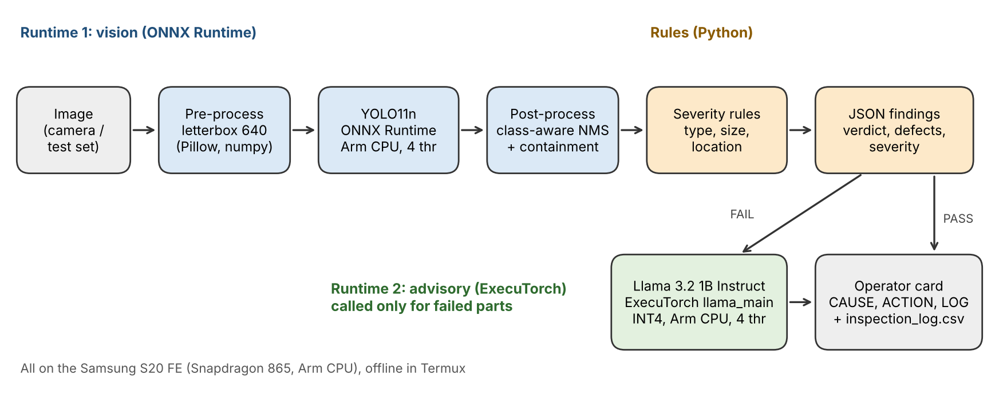

# Steel Surface QC Assistant on an Arm Phone

**Arm Bharat AI-SoC Challenge 2026, Problem Statement 5: real-time industrial defect detection and quality-control assistant on an Arm SoC.**

Team:  
AKSHAYAA T  | MANUSHRI RAVI SHANKARAN  
PSG INSTITUTE OF TECHNOLOGY AND APPLIED RESEARCH

A fully offline quality-control assistant for hot-rolled steel strip. It runs entirely on the Arm CPU of a Samsung Galaxy S20 FE 5G (Snapdragon 865):

1. **Detect**: YOLO11n (fine-tuned on the real NEU-DET steel defect dataset) finds and classifies 6 surface defect types. Runtime: **ONNX Runtime** on the Arm CPU.
2. **Grade**: transparent rules turn each detection into **Low / Medium / High** severity from defect **type, size and location**. Confidence is never used as severity. Any defect gives a rule-based **FAIL**.
3. **Advise**: for every FAIL, **Llama 3.2 1B Instruct** (INT4, **ExecuTorch**) reads the JSON findings and writes a 3-line operator note: likely CAUSE, ACTION, and a LOG line.
4. **Log**: every inspection is appended to `inspection_log.csv` (verdict, defects, timings, advice).

No cloud, no network: all benchmarks below were run with the phone in airplane mode.



```
image ─► pre-process (Pillow/numpy) ─► YOLO11n (ONNX Runtime, Arm CPU) ─► NMS
      ─► severity rules ─► JSON findings ─┬─ PASS ─► log
                                          └─ FAIL ─► Llama 3.2 1B (ExecuTorch, Arm CPU) ─► CAUSE / ACTION / LOG ─► log
```

## Results (on the phone, offline)

Test set: 361 NEU-DET validation images, never seen in training. Box-level metrics use IoU ≥ 0.5 with class match.

| | **YOLO11n 640 (main)** | YOLO11n 320 (speed comparison) |
|---|---|---|
| Precision / Recall / F1 (phone, box level) | **0.760 / 0.670 / 0.712** | 0.767 / 0.630 / 0.692 |
| mAP50 / mAP50-95 (Colab validation) | 0.739 / 0.404 | 0.716 / 0.385 |
| Vision latency per image (pre / infer / post) | 113.7 ms (16.7 / 95.7 / 1.2) | 32.7 ms (5.0 / 27.0 / 0.7) |
| Vision throughput | 8.8 FPS | 30.5 FPS |
| Vision process memory (peak RSS) | 150 MB | 86 MB |
| Images flagged as defective | 351 / 361 | 333 / 361 |

| Llama 3.2 1B Instruct (ExecuTorch, INT4 SpinQuant) | |
|---|---|
| Time to first token | ~0.5 s |
| Prefill / decode speed | ~125 tok/s / ~22 tok/s |
| Model load | ~4 s |
| Total advisory time per FAIL (20-image run) | 8.77 s mean, 9.1 s p95 |
| Memory (peak RSS) | ~1.37 GB |

Confidence threshold: default 0.25 (best F1), `--conf 0.15` as a zero-miss mode; full sweep and clean-surface test in `benchmarks.md`.

Power (continuous 640 vision, airplane mode, screen on): **5.3 W vs 0.67 W idle**, about 0.54 J per image above idle; battery 36.1 → 42.4 °C over 5 minutes with ~6% slowdown (113 → 121 ms) from mild thermal throttling.

Full numbers and method: [`benchmarks.md`](benchmarks.md) and the final report.

## Repository layout

```
├── README.md                     this file
├── qc_inspector.py               the on-device pipeline (vision + rules + Llama + log + benchmark)
├── RUN_ON_PHONE.md               how to install and run it on the phone (Termux)
├── train_yolo11n_neu_640.ipynb   Colab: NEU-DET download, YOLO training at 640, ONNX export (main model)
├── train_yolo11n_neu_320.ipynb   same at 320 (speed comparison)
├── llama_executorch_setup.md     building llama_main with ExecuTorch and running Llama on the phone
├── severity_rules.md             how Low / Medium / High is decided
├── benchmarks.md                 all measured numbers
├── yolo11n_neu_640.onnx          main detector (640 input), ONNX, ~10 MB
├── yolo11n_neu.onnx              speed-comparison detector (320 input), ONNX
├── labels.txt                    class names in index order
└── results/figures/              pipeline diagram
```

The Llama 3.2 1B `.pte` (1.1 GB) and `tokenizer.model` are not stored here: download them from Hugging Face `executorch-community/Llama-3.2-1B-Instruct-SpinQuant_INT4_EO8-ET` (see `llama_executorch_setup.md`).

## Quick start (Samsung S20 FE or any arm64 Android phone, Termux)

1. Install Termux from F-Droid, then:
   ```
   pkg install -y python python-numpy python-pillow python-onnxruntime unzip
   ```
2. Put `qc_inspector.py`, `yolo11n_neu_640.onnx` and `labels.txt` in `~/qc`. Put a test set (images + YOLO label files) in `~/qc/test_images` and `~/qc/test_labels` (the training notebook builds one).
3. Set up Llama in `~/llama` (`llama_main`, `libc++_shared.so`, the `.pte` and `tokenizer.model`): see [`llama_executorch_setup.md`](llama_executorch_setup.md).
4. Run:
   ```
   cd ~/qc
   python qc_inspector.py inspect --model yolo11n_neu_640.onnx --image test_images/<file>.jpg
   python qc_inspector.py bench --model yolo11n_neu_640.onnx --images test_images --labels test_labels
   python qc_inspector.py bench --model yolo11n_neu_640.onnx --images test_images --labels test_labels --llama --limit 20 --save-annotated out640
   ```

Useful flags: `--conf` (confidence threshold, default 0.25), `--no-llama` (vision + rules only), `--save-annotated <dir>` (boxed images coloured by severity).

## Reproduce training

Open `train_yolo11n_neu_640.ipynb` in Google Colab with a T4 GPU and run top to bottom (about 45 to 60 minutes). It downloads NEU-DET from Kaggle, trains YOLO11n (COCO-pretrained, seed 0), prints per-class metrics, exports `yolo11n_neu_640.onnx` and builds a phone bundle with the validation images as the test set.

## Datasets and models

- **NEU-DET** (Northeastern University surface defect database): 1,800 real grayscale 200×200 images of hot-rolled steel, 6 classes (crazing, inclusion, patches, pitted_surface, rolled-in_scale, scratches). Kaggle mirror `kaustubhdikshit/neu-surface-defect-database`.
- **Own clean-metal photos**: 40 photos of defect-free metal taken with the phone camera, used only as a false-alarm test set.
- **YOLO11n** by Ultralytics (AGPL-3.0).
- **Llama 3.2 1B Instruct**, ExecuTorch build `executorch-community/Llama-3.2-1B-Instruct-SpinQuant_INT4_EO8-ET` on Hugging Face (Llama 3.2 Community License). The `.pte` (1.1 GB) is not stored in this repo; download it from Hugging Face.

## Limitations

See the final report for detail. In short: NEU-DET is a lab dataset of small 200×200 crops; severity thresholds are in % of image area, not millimetres; vision and Llama run on the CPU only (GPU/NPU not used yet); Llama takes about 9 s per failed part, so advice arrives after the verdict, not with it.

## Next steps

- Fewer false alarms: train with clean, defect-free photos (hard negatives) from the target camera and surface.
- Cross-surface generalisation: adapt to new surface types (e.g. KolektorSDD commutators) by fine-tuning with clean hard-negative images.
- Live camera input and an operator screen; resident, asynchronous Llama; INT8 and GPU/NPU execution.

## License

No licence file yet. Built with Ultralytics YOLO11 (AGPL-3.0), ONNX Runtime (MIT), ExecuTorch (BSD) and Llama 3.2 (Llama 3.2 Community License); check those terms before reuse.
